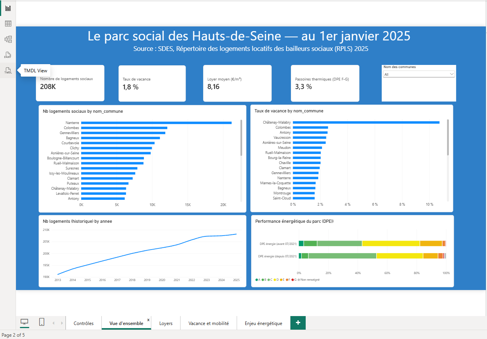
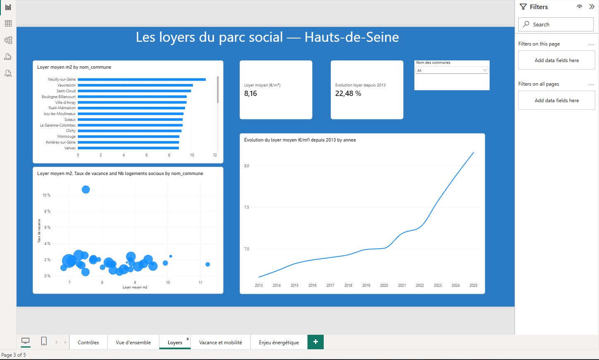
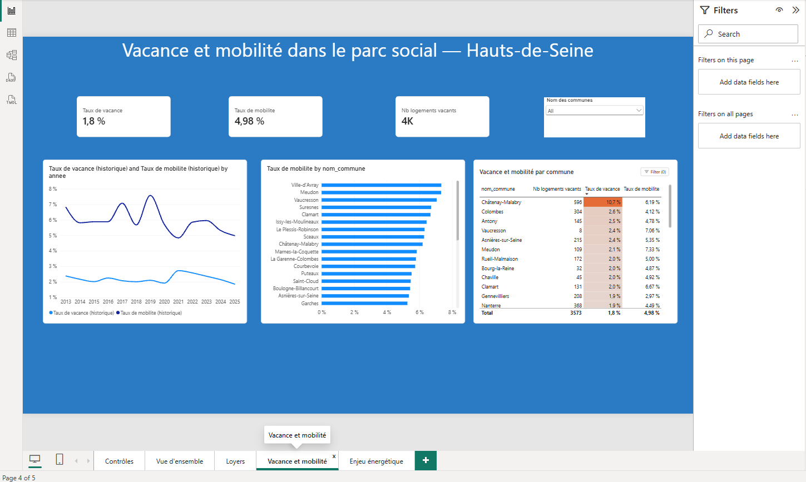
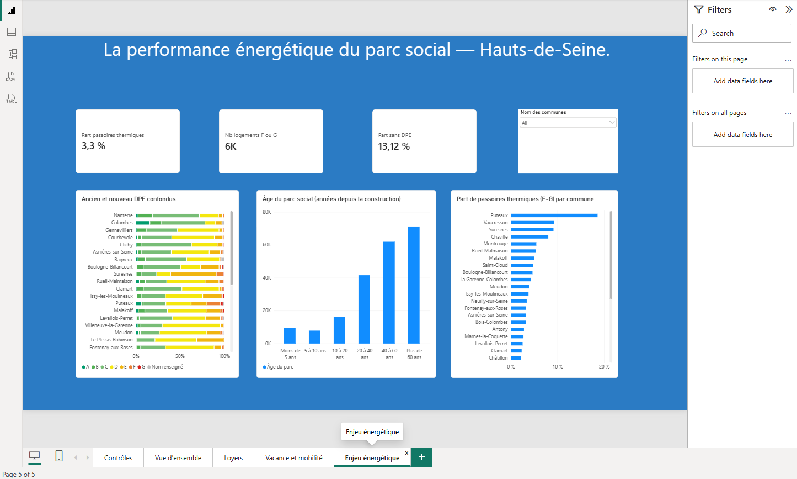

# Le parc social des Hauts-de-Seine — Dashboard Power BI

Analyse du parc de logements sociaux des Hauts-de-Seine (92) à partir des données publiques
**RPLS** (Répertoire des logements locatifs des bailleurs sociaux, SDES — ministère de la
Transition écologique) : volume, loyers, vacance, mobilité et performance énergétique,
pour les 36 communes du département, de 2013 à 2025.

**Pipeline :** fichier Excel du ministère → préparation en Python (pandas) → modèle en étoile
→ mesures DAX → dashboard Power BI de 4 pages.

## Aperçu

### Vue d'ensemble



### Loyers



### Vacance et mobilité



### Enjeu énergétique



## Constats clés

Données au 1er janvier 2025, sauf mention contraire.

- **208 204 logements sociaux** dans le 92. Le parc a progressé d'environ 191 000 logements
  en 2013 à 208 000 en 2025. **Nanterre** en concentre le plus (21 190).
- **Loyers : +22,5 % en 12 ans.** Le loyer moyen passe d'environ 6,7 €/m² en 2013 à
  **8,16 €/m²** en 2025, avec une hausse plus rapide à partir de 2022.
  **Neuilly-sur-Seine** a le loyer moyen le plus élevé (11,22 €/m²).
- **Une vacance très faible (1,8 %), sauf à Châtenay-Malabry.** Cette commune affiche
  **10,7 %** de vacance (596 logements), près de 6 fois la moyenne du département.
  Le nuage de points loyer / vacance ne montre **pas de lien direct entre le niveau de
  loyer et la vacance** : la situation de Châtenay-Malabry relève d'un facteur local.
- **Une mobilité en baisse.** Le taux de rotation des locataires recule d'environ 7 %
  en 2013 à **5 %** en 2025 : les locataires restent plus longtemps, ce qui libère
  moins de logements pour les nouveaux demandeurs.
- **3,3 % de passoires thermiques (DPE F ou G)**, soit environ 6 000 logements, mais avec
  de fortes disparités : **Puteaux** atteint environ **20 %**. Depuis 2025, les logements
  classés G ne peuvent plus être mis en location, et les logements F seront concernés en 2028.
- **13,1 % du parc n'a pas de DPE renseigné.**
- **Un parc ancien** : la majorité des logements ont plus de 40 ans. La faible part de
  passoires malgré cette ancienneté laisse supposer des rénovations, ce que les données
  ne permettent pas de vérifier directement.

## Architecture

```
Fichier RPLS 2025 (SDES)  →  Python (pandas)  →  4 CSV (modèle en étoile)  →  Power BI
   data/raw/                  scripts/              data/processed/              powerbi/
                              prepare_data.py
```

### Modèle de données

```
                 dim_commune (36 lignes)             dim_annee (2013 → 2025)
              /          |           \                        |
           1:*          1:*          1:*                     1:*
            /            |             \                      |
     fact_parc     fact_evolution   fact_repartition ─────────┘ (relié à fact_evolution)
```

| Table              | Grain                                   | Contenu                                                                                         |
| ------------------ | --------------------------------------- | ----------------------------------------------------------------------------------------------- |
| `dim_commune`      | 1 ligne par commune                     | code INSEE, nom, département                                                                    |
| `dim_annee`        | 1 ligne par année                       | table calculée en DAX (2013 → 2025)                                                             |
| `fact_parc`        | 1 ligne par commune                     | photo du parc au 1er janvier 2025 : effectifs, vacance, mobilité, loyers, mises en service, DPE |
| `fact_evolution`   | 1 ligne par commune et par année        | historique 2013–2025 : nb de logements, vacance, mobilité, loyer moyen, mises en service        |
| `fact_repartition` | 1 ligne par commune, thème et catégorie | répartition du parc : pièces, type de construction, financement, âge, DPE                       |

Relations un-à-plusieurs, filtre dans un seul sens (des dimensions vers les faits).

### Mesures DAX principales

Les taux et moyennes sont **recalculés** à chaque niveau (commune, sélection, département)
au lieu d'additionner les colonnes du fichier :

```dax
Taux de vacance =
DIVIDE([Nb logements vacants], SUM(fact_parc[nb_loues]) + [Nb logements vacants])

Loyer moyen m2 =
DIVIDE(
    SUMX(fact_parc, fact_parc[loyer_moyen_m2] * fact_parc[nb_logements_sociaux]),
    [Nb logements sociaux]
)

Part passoires thermiques = DIVIDE([Nb logements F ou G], [Nb logements avec DPE])
```

Les mesures ont été vérifiées sur une page de contrôle masquée : le taux de vacance
recalculé correspond à celui publié par le ministère pour chaque commune.

## Choix techniques

- **Une seule source, le millésime 2025.** Les fichiers 2020 à 2023 n'ont pas de codes de
  colonnes, et leurs titres changent d'une année à l'autre. Le fichier 2025 contient déjà
  l'historique 2013–2024, avec les chiffres révisés par le ministère : il est plus fiable
  que l'assemblage de plusieurs millésimes.
- **Détection automatique de la structure** du fichier Excel (feuille, ligne des codes)
  et **contrôle qualité** dans le script : chaque répartition (pièces, âge, financement…)
  doit retomber sur le total des logements.
- **Format long** pour l'historique et les répartitions (une ligne par année ou par
  catégorie), mieux adapté à Power BI qu'une colonne par année.
- **DPE :** les étiquettes établies avant et après la réforme de juillet 2021 ne sont pas
  calculées de la même façon. Elles sont présentées séparément, et additionnées uniquement
  pour la vue par commune, ce qui est indiqué sur le visuel.

## Limites

- Le loyer moyen et le taux de mobilité au niveau du département sont des **moyennes
  pondérées par le nombre de logements** : le ministère pondère les loyers par la surface,
  qui n'est pas disponible dans le fichier communal.
- Les données décrivent le parc au 1er janvier de chaque année ; elles n'expliquent pas
  les causes des écarts entre communes.

## Données

Source : SDES (ministère de la Transition écologique), fichier
« Données nationales : régions, départements, EPCI et communes — RPLS au 1er janvier 2025 »,
feuille des communes.

- Téléchargement : https://www.statistiques.developpement-durable.gouv.fr/media/8938/download?inline
- À enregistrer sous `data/raw/rpls_2025.xlsx` (les fichiers bruts ne sont pas versionnés).
- Dictionnaire des colonnes : [`docs/columns/2025.txt`](docs/columns/2025.txt).

<details>
<summary>Millésimes précédents</summary>

| Millésime | Lien                                                                              |
| --------- | --------------------------------------------------------------------------------- |
| 2024      | https://www.statistiques.developpement-durable.gouv.fr/media/7970/download?inline |
| 2023      | https://www.statistiques.developpement-durable.gouv.fr/media/6897/download?inline |
| 2022      | https://www.statistiques.developpement-durable.gouv.fr/media/6006/download?inline |
| 2021      | https://www.statistiques.developpement-durable.gouv.fr/media/4997/download?inline |
| 2020      | https://www.statistiques.developpement-durable.gouv.fr/media/4096/download?inline |

</details>

## Lancer le projet

```bash
git clone https://github.com/Fidelia-x/Social-housing-dashboard-92.git
cd Social-housing-dashboard-92
pip install -r requirements.txt
python scripts/inspect_columns.py   # (optionnel) liste des colonnes de chaque fichier dans docs/columns/
python scripts/prepare_data.py      # produit les 4 CSV dans data/processed/
```

Puis ouvrir `powerbi/social_housing_92.pbix` dans Power BI Desktop.

## Structure du repo

```
├── data/
│   ├── raw/                  # fichiers bruts du ministère (non versionnés)
│   └── processed/            # 4 tables CSV prêtes pour Power BI
├── docs/
│   ├── columns/2025.txt      # dictionnaire des colonnes de la source
│   └── screenshots/          # captures du dashboard
├── powerbi/
│   ├── social_housing_92.pbix
│   └── theme_parc_social.json
├── scripts/
│   ├── inspect_columns.py    # exploration de la structure des fichiers
│   └── prepare_data.py       # nettoyage, filtrage et modélisation
└── requirements.txt
```

## Stack

Python · pandas · Power BI (Power Query, modèle en étoile, DAX) · Git

## Ce que j'ai appris

- **Explorer avant de construire :** l'inspection des fichiers a révélé deux formats
  différents selon les années, ce qui a conduit à simplifier le pipeline autour d'une seule
  source fiable.
- **Modéliser en étoile :** séparer dimensions et faits, définir le grain de chaque table
  et choisir les bonnes cardinalités.
- **Recalculer les taux avec des mesures DAX** au lieu d'additionner des moyennes, et
  vérifier les résultats par rapport aux chiffres officiels.
- **Comprendre le métier** derrière les chiffres : vacance, mobilité, réforme du DPE et
  calendrier d'interdiction de location des passoires thermiques.

---

Fidélia Sowakoude — [GitHub](https://github.com/Fidelia-x)
